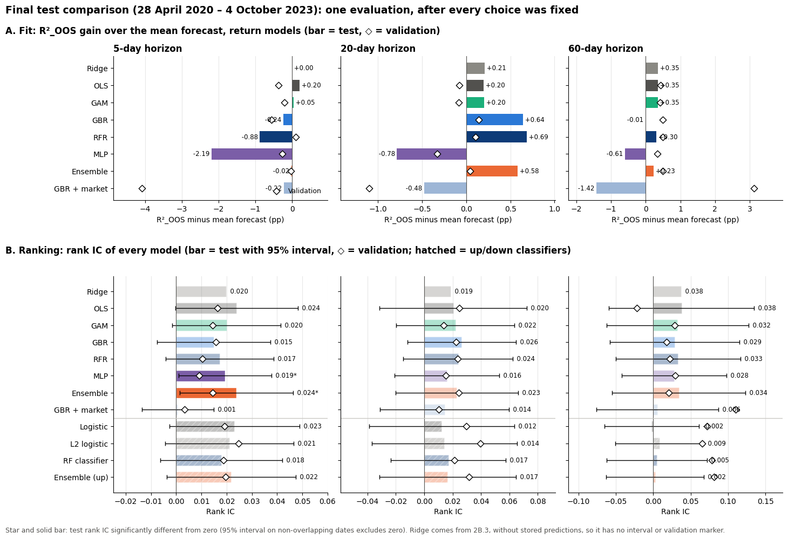
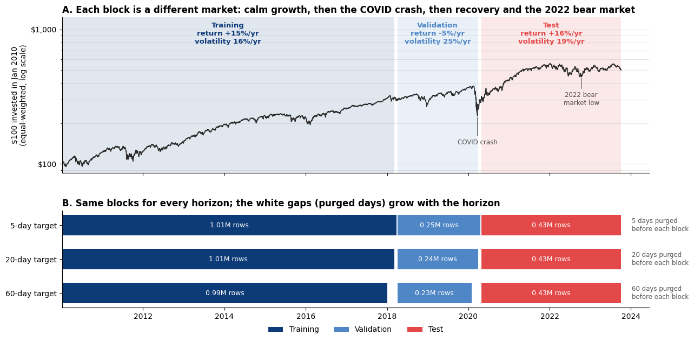
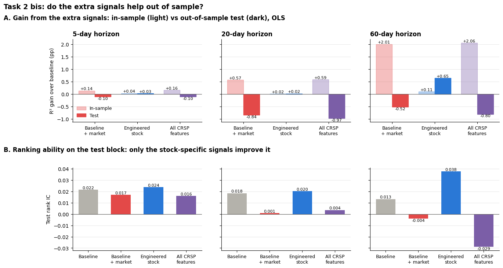
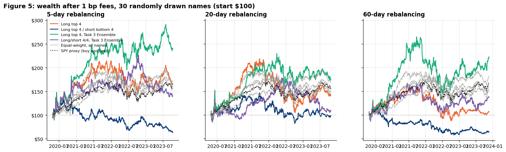
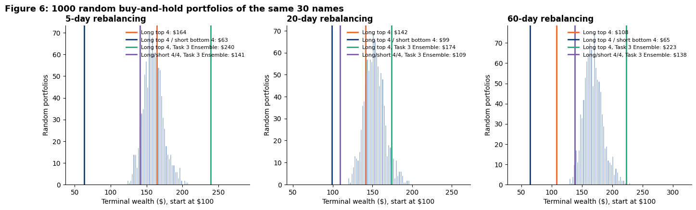
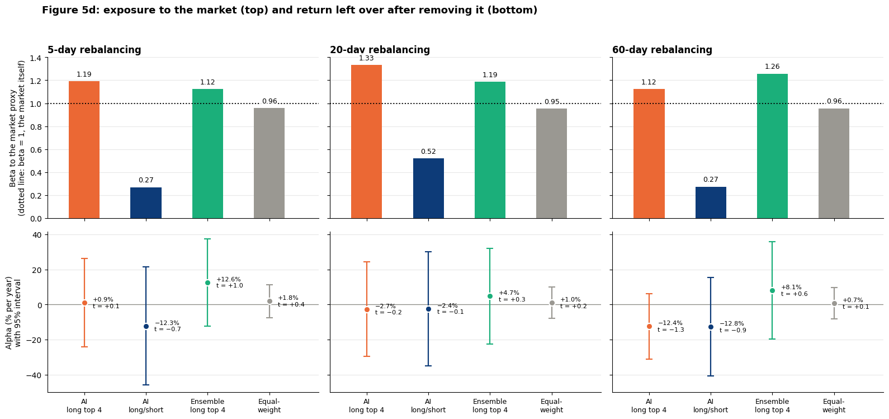

# Machine Learning for Cross-Sectional Stock Returns: Forecasts, Rank IC and a Cost-Aware Backtest

Can price and volume signals predict which S&P 500 stocks will outperform over the next 5, 20 or 60 trading days? This project builds a survivorship-aware CRSP panel of 1.7 million stock-days (2010–2023), compares linear models, a GAM, gradient-boosted trees, random forests and a Gu–Kelly–Xiu style neural network under a purged chronological split, and then turns the forecasts into a long-only and long/short portfolio tested against random portfolios, a placebo and 20 alternative universes, after trading costs.

> **Status:** completed team project (4 authors), originally developed as coursework in an MSc finance course at Bocconi University. The notebook has been reorganised and lightly edited for readability since submission; methods and results are unchanged. See [Authors](#authors-and-contributions) and [Disclaimer](#disclaimer).
>
> **Related projects:** [StockTwits sentiment & asset pricing](https://github.com/ceciliaalocicero/stocktwits-sentiment-asset-pricing) · [CAPM tests](https://github.com/ceciliaalocicero/capm-empirical-tests-sp500) · [Markowitz backtest](https://github.com/ceciliaalocicero/markowitz-portfolio-optimization-backtest)

---

## Research questions

1. Do past returns and trading volume predict future stock returns, and does machine learning extract more than OLS?
2. Is it easier to predict the *direction* of a return than its *size*?
3. Does a model-ranked portfolio beat passive alternatives once concentration, market beta and costs are accounted for?

## Key findings

| # | Finding | Evidence |
|---|---------|----------|
| 1 | **Predictability is small, and most of OLS's "skill" is the market drift.** On the 2020–2023 test block, OLS reaches R²_OOS of 0.36%, 0.93% and 2.08% at 5, 20 and 60 days, but a forecast that always predicts the training-period mean gets 0.18%, 0.75% and 2.38%. Ridge adds nothing with six predictors and ~1M observations. | Pooled OLS/Ridge, purged chronological split |
| 2 | **Stock-specific signals help; market-wide signals overfit.** Engineered stock features (1-day reversal, volatility, volume shocks, firm size) raise the 60-day test R²_OOS by 0.65 pp and triple the rank IC (0.013 → 0.038). Market variables raise the in-sample fit but lower every test metric. Gradient boosting with market variables gains +3.1 pp on validation and then posts the worst 60-day test result (−1.42 pp). | 4 feature sets × OLS/Ridge; GBR with and without market data |
| 3 | **Non-linear models do not dominate.** Trees give the best 20-day fit (+0.64 to +0.69 pp over the mean forecast); the neural network has the worst fit but, with the 5-model ensemble, the only statistically significant rank IC (≈0.02 at 5 days, t ≈ 2.1). A GAM matches OLS, so the relations are close to linear. | OLS, Ridge, GAM, HistGBR, random forest, NN3 (5-seed average), ensemble |
| 4 | **Direction classifiers add nothing beyond the base rate.** Logistic, L2-logistic and random-forest classifiers predict "up" for 98–100% of stock-days; balanced accuracy is 50.0–50.6% even with a daily-median rule. | Log loss, AUC, calibration, confusion matrices |
| 5 | **The AI portfolio does not beat passive investing on a risk-adjusted basis.** Long top 4 of 30 random S&P 500 names, 1 bp fees: \$164 / \$142 / \$108 per \$100 at 5 / 20 / 60 days, vs \$162 / \$155 / \$168 for the market proxy, with lower Sharpe ratios (0.60 / 0.46 / 0.22 vs 0.85 / 0.78 / 0.90). Returns are explained by a beta of 1.1–1.3 (alpha t-stats −1.3 to +0.1); long/short loses money at every horizon. A random-score placebo and 20 alternative universes show that one universe's result is mostly luck. | 1,000 random portfolios, placebo, 20 universes, fee sensitivity 0–10 bp |

**Bottom line:** a rank IC around 0.02 is real but economically small. Concentrated into four stocks, it is swamped by noise and market beta. This is consistent with the small predictability reported by Gu, Kelly and Xiu (2020), in a much narrower setting (large caps, few signals, a 3.4-year test).

---

## Selected results

**Final test comparison: fit (R²_OOS gain over the mean forecast) and ranking ability (rank IC) of every model**



**Chronological split: what the market did in each block**



**Do extra signals help out of sample?**



**Portfolio wealth after 1 bp fees, 30 random S&P 500 names**



**Strategies vs the distribution of 1,000 random portfolios**



**Skill or market exposure? Beta and alpha against the market proxy**



All 21 figures are in [`figures/`](figures/).

---

## Data

| Dataset | Content | Access | Included? |
|---------|---------|--------|-----------|
| CRSP daily file, S&P 500 constituents | 2.15M security-days, 873 PERMNOs, 2007–2023: returns, prices, volume, shares outstanding, adjustment factors, market cap | WRDS (licensed) | **No** |
| Eight-stock price and volume files | Daily close and volume for AAPL, BA, T, MGM, AMZN, IBM, TSLA, GOOG and the S&P 500, 2012–2020 | Course-provided | **No** |

The modelling panel has **1,698,021 stock-days for 756 stocks** (4 Jan 2010 – 4 Oct 2023), with one share class per company. Stocks that left the index are kept; rolling windows never cross a gap in index membership. See [`data/README.md`](data/README.md).

---

## Methodology

**Data checks (Task 1).** The GOOG volume series in the course file splices two securities around the April 2014 Class C share issue. This was identified from a 0.4% min/median volume ratio and confirmed against CRSP PERMNOs. CRSP volumes are split-adjusted with the cumulative share factor. Volume–return analysis shows a V-shape: volume predicts the size of future moves, not their direction.

**Prediction problem.**
- **Target:** cumulative log return over the next *h* ∈ {5, 20, 60} trading days.
- **Predictors** (known at the close of day *t*): past returns and relative volume over 5/20/60 days, extended with 1-day reversal, 20-day volatility, volume shocks and log company market cap (aggregated by PERMCO).

**Validation design.**
- Chronological 75/25 split; the last 20% of training is the validation block.
- Each boundary is **purged by *h* days** so that no target overlaps the next block.
- Clipping (1st/99th percentile) and standardisation sit inside each pipeline and are fitted on training rows only.
- Hyperparameters are chosen on validation; each model is refitted on train + validation and scored **once** on the test block (28 Apr 2020 – 4 Oct 2023).

**Metrics.**
- R²_OOS against a zero forecast, as in Gu–Kelly–Xiu, and the demeaned R².
- MSE, MAE and sign accuracy.
- **Daily rank IC**, with t-statistics on non-overlapping dates.
- For classifiers: log loss, Brier score, AUC, balanced accuracy and calibration.

**Models.**

| Type | Models |
|------|--------|
| Linear | Mean forecast, OLS, Ridge (λ on a 25-point log grid) |
| Additive | GAM: cubic splines per predictor + Ridge penalty |
| Trees | Histogram gradient boosting, random forest |
| Neural net | NN3 (32-16-8), average of 5 seeds, tuned L2 penalty |
| Classifiers | Logistic, L2 logistic, random forest (direction of return) |
| Combination | Equal-weight ensembles, fixed in advance |

**Portfolio (Task 4).**
- **Universe:** 30 stocks drawn at random (seed 7) from the 491 index members on the first test day.
- **Positions:** long top 4 (and long/short 4/4), equal weight, rebalanced every *h* days.
- **Costs:** 1 bp one-way fee on turnover.
- **Forecasts:** walk-forward refits every 126 days (purged); the signal type is chosen on validation only.
- **Benchmarks:** equal weight, a value-weighted market proxy, 1,000 Dirichlet random buy-and-hold portfolios, a random-score placebo, and 20 alternative universes.
- **Diagnostics:** beta/alpha regressions, a fee sweep (0–10 bp), and an engine check that reproduces the training targets to 10⁻¹⁶.

---

## Repository structure

```
ml-return-prediction-sp500/
├── README.md
├── LICENSE
├── requirements.txt
├── .gitignore
├── notebooks/
│   └── ml_stock_return_prediction.ipynb   # full analysis, committed with its original outputs
├── figures/                               # 21 charts taken from the notebook outputs
├── data/
│   └── README.md                          # data sources, expected files, cache
└── references/
    └── README.md
```

## Technologies

Python · pandas · NumPy · scikit-learn (Ridge, logistic, HistGradientBoosting, random forests, MLP, SplineTransformer) · joblib · Matplotlib · CRSP via WRDS

## How the notebook was produced

The notebook is committed **with the outputs of its original runs** and was not re-executed for publication. Model fits are cached with joblib on first run and reloaded afterwards. Raw CRSP and course-data rows have been removed from the outputs for licensing reasons, and library warning messages have been cleared.

## Reproducing the analysis

```bash
git clone https://github.com/ceciliaalocicero/ml-return-prediction-sp500.git
cd ml-return-prediction-sp500
python -m venv .venv
.venv\Scripts\activate          # macOS/Linux: source .venv/bin/activate
pip install -r requirements.txt
```

1. Place the data files as described in [`data/README.md`](data/README.md).
2. Open `notebooks/ml_stock_return_prediction.ipynb` and run the cells in order. All seeds are fixed (`SEED = 7`).
3. The first run builds the panel and fits every model, which takes a long time on a laptop because of the random forests and the 5-seed network. Results are cached in `cache/` (git-ignored). Library versions differ from the original run, so small numerical differences are possible.

## Limitations

- **One test path.** 3.4 years, dominated by the post-COVID rebound and the 2022 downturn.
- **Narrow information set.** 10 price/volume signals on large caps; there are no accounting characteristics, unlike Gu–Kelly–Xiu.
- **Overlapping targets.** With few independent observations at 20/60 days, rank-IC tests have low power.
- **Many portfolio variants on the same test block.** 54 basket and weighting combinations are shown for transparency; the best cells are a maximum over many trials.
- **Execution assumptions.**
  - Trades execute at the same close used to compute the signal.
  - No borrowing costs; short proceeds earn no interest.
  - Mild survivorship filter: a stock needs a complete 60-day future to be ranked.
- **Random-portfolio benchmark** mixes skill with concentration; the placebo and multi-universe tests address this only partly.

## Authors and contributions

Team project by **Cecilia Lo Cicero, Sara Pulidori, Alissa Sharuda and Nico Visentin**.

Repository prepared and maintained by **Cecilia Lo Cicero**. All four authors contributed jointly to every stage of the project: data preparation, modelling, the portfolio backtest and the write-up.

Developed as coursework for *Finance with Big Data* (MSc, Bocconi University). The assignment framework was provided by the course; the analysis, extensions and write-up are the team's own.

## References

- Gu, S., Kelly, B., & Xiu, D. (2020). Empirical asset pricing via machine learning. *Review of Financial Studies*, 33(5), 2223–2273.
- Jiang, J., Kelly, B., & Xiu, D. (2023). (Re-)Imag(in)ing price trends. *Journal of Finance*, 78(6), 3193–3249.
- Jegadeesh, N. (1990). Evidence of predictable behavior of security returns. *Journal of Finance*, 45(3), 881–898.
- Karpoff, J. M. (1987). The relation between price changes and trading volume: A survey. *Journal of Financial and Quantitative Analysis*, 22(1), 109–126.
- Lo, A. W., & Wang, J. (2000). Trading volume: Definitions, data analysis, and implications of portfolio theory. *Review of Financial Studies*, 13(2), 257–300.
- López de Prado, M. (2018). *Advances in Financial Machine Learning*. Wiley (purged cross-validation).
- DeMiguel, V., Garlappi, L., & Uppal, R. (2009). Optimal versus naive diversification. *Review of Financial Studies*, 22(5), 1915–1953.
- Hastie, T., Tibshirani, R., & Friedman, J. (2009). *The Elements of Statistical Learning* (2nd ed.). Springer.

## Disclaimer

This is an educational project and not investment advice. All backtests are historical and hypothetical; they ignore market impact, borrowing costs and taxes. No CRSP or course data are redistributed.

## License

Code is released under the [MIT License](LICENSE). Data remain subject to their providers' terms.
